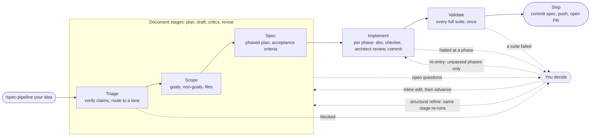

# spec-pipeline

**A rigorous, resumable, five-stage spec-to-PR pipeline for Claude Code.**

- **MIT licensed**: copy it, fork it, bend it to your stack.
- **Built on Claude Code Dynamic Workflows**: one slash command plus one workflow script. No server, no daemon, no database.
- **Stack-agnostic**: lanes, agents, test commands, and invariants are configuration, not code.
- **Zero runtime dependencies**: Markdown, JSON, and one plain JavaScript file.

---

You describe a change in plain English. The pipeline turns it into a pull request through five stages:
**triage → scope → spec → implement → validate**, followed by **ship**. Each document stage writes a
reviewable Markdown artifact into your repository. Implement executes the spec phase by phase with a
routed specialist agent, an evidence-based checker, and an architect review, and commits each phase as it
passes. Validate runs your full test suites exactly once. Ship commits the spec, pushes, and opens the PR
with the results in its body.

What makes it different is where the rigor lives. **State lives in git-tracked artifacts, not in a
process.** Any session, including one started tomorrow after `/resume`, re-derives where a workstream
stands from the files on disk. **One stage runs per call**, and the orchestrator reviews every return
before it moves. **Every document is drafted, audited by an adversarial critic, and revised**, and scope
and spec plan their own composition first, so a large source is split across parallel drafters with every
commitment tracked instead of silently dropped.
**Open questions are a first-class channel**: a stage that cannot decide something hands you a short,
plain-language decision with 2-4 options instead of guessing past it. **Everything fails closed**: a dead
agent, a self-contradicting review, or a missing verdict is a halt, never a pass.

It is for teams and solo developers who already use Claude Code on a real codebase and want large
changes to arrive as a written record (what was verified, what was decided, by whom, and why) plus a PR,
instead of as a long chat transcript.

## Adopt it in one sentence

> Point your coding agent at this repository and say:
>
> **`Adopt the spec-pipeline project at https://github.com/raseley/spec-pipeline into my software project. Follow its ADOPT.md.`**

[`ADOPT.md`](ADOPT.md) is written for the agent, not for you. It is a deterministic procedure with
explicit verification gates. The agent derives everything it can from your repository (directories,
languages, test runners, existing `CLAUDE.md`/`AGENTS.md`, existing agents and rules) and asks you only for
what it cannot derive:

- which **lanes** your project has (independently tested areas such as `api` and `web`, or just one);
- the **full-suite test command** for each lane and roughly how long it takes;
- your **base branch** and whether your forge allows **merge commits**;
- the **model tiers** your account can run;
- the **2-5 invariants** that are catastrophic to violate (it proposes candidates from your code).

It will not ask you to design prompts, write JSON, or pick slugs. It finishes with a verification run and
a report of every file it added or changed.

## The stages

Between every pair of stages sits the orchestrator's **gate**. It auto-advances only when nothing needs
you: no error, no open question, no block, a clean critic verdict, no halted phase, every suite green.
Anything else stops the chain and tells you exactly why.

| Stage | Who does the work | Writes | Default tier | What stops it |
|---|---|---|---|---|
| **Triage** | the triage agent (a lane architect by default) + a critic | `docs/specs/<slug>-triage.md` | `opus` | blocked routing, open decisions, a malformed or divergent return, an unclean critique |
| **Scope** | the workstream's lane architect: a plan, 1-6 partition drafters, a synthesizer, parallel lens critics | `docs/specs/<slug>-scope.md` | `opus` | open questions, an unclean critique, a source commitment that may have been dropped |
| **Spec** | the lane architect: a plan, 1-6 partition drafters, a synthesizer, a four-lens critic panel plus plain-JS checks | `docs/specs/<slug>.md` | `fable` (top tier) | open questions, an unclean critique, a scope goal or phase that may have been dropped |
| **Implement** | per phase: the routed agent, a criteria checker, the lane's architect, a committer | one commit per phase on branch `<prefix>/<slug>`, after the orchestrator's spec commit at approval | `opus` | the first phase with unmet criteria, a blocking concern, a failed commit, or a dead agent |
| **Validate** | one runner agent | nothing (report only) | `sonnet` | any suite with a failure or an error |
| **Ship** | the orchestrator itself | leftover commits, push, PR, artifact removal | (main session) | a failed push or PR creation |

## What you get

**The payload** (copied into your repository):

| File | What it is |
|---|---|
| `.claude/commands/spec-pipeline.md` | The `/spec-pipeline` orchestrator: classifies your prose, derives the next stage from disk, assembles the workflow's `args`, reviews every return, runs the gate, and ships. |
| `.claude/workflows/spec-pipeline.js` | The Dynamic Workflow script: one stage per call, every prompt, every schema, every fail-closed check. |
| `.claude/spec-pipeline.json` | Your project's configuration: lanes, agents, suites, invariants, model tiers. The only file you normally edit. |
| `docs/specs/triage-template.md`, `scope-template.md`, `spec-template.md` | The three artifact templates the agents write against, with their own composition-time self-checks. |
| `docs/specs/README.md` | What lives in the specs directory and the two rules about it. |

**The starter kit** (merged or adapted, never copied blindly): lean architect and dev agent definitions per
lane, a docs agent, a steering-file section for `CLAUDE.md`, a path-scoped rule example, an enforcement
hook skeleton, a pattern-doc index skeleton, and a `settings.json` snippet. See
[`starter-kit/README.md`](starter-kit/README.md).

All examples in this repository use one fictional project, **Orderly**: an order-management app with a
Python/FastAPI `api` lane and a TypeScript/React `web` lane. See a full run in
[`docs/walkthrough.md`](docs/walkthrough.md).

## Prerequisites

| Requirement | Why the pipeline needs it | What good looks like |
|---|---|---|
| **Claude Code** with the `Workflow` tool (Dynamic Workflows), slash commands, custom subagents, `AskUserQuestion`, and `/resume` | The pipeline is a command plus a workflow script. Stages fan out to subagents; open questions reach you through `AskUserQuestion`. | `.claude/commands/` and `.claude/workflows/` are picked up when a session starts. |
| **git**, a base branch, and a remote | The orchestrator creates `<prefix>/<slug>` off the latest base, commits, and pushes. | `git pull` on the base branch works without prompts. |
| **`gh` CLI**, authenticated, and a GitHub remote | Stage derivation checks for open or merged PRs; ship opens the PR. Only GitHub is implemented: with another host, everything through validate works and you open the PR yourself. | `gh auth status` succeeds; `gh repo view --json url` prints the repo. |
| **Merge commits** (or `ship.remove_artifacts_after_pr: false`) | Ship links the spec by commit SHA and then removes the artifacts from the branch tip. A squash merge would drop that SHA from the base branch. | Your forge allows merge commits, or you keep artifacts in the merged history. |
| **A steering file** (`CLAUDE.md`, optionally importing `AGENTS.md`) with stable headings | Prompts cite it **by heading**: the routing table, the invariants, the anti-patterns, the reference table. | One `###` heading per invariant; an `### Agent Selection` table that lists every agent. |
| **One architect and one dev agent per lane** | Architects draft and review; devs implement. The routing token is the agent's file name. | Lean (~60-line) definitions built from the starter kit. `general-purpose` works as a fallback. |
| **Cheap targeted tests and one correct full-suite command per lane** | Phases run targeted selections only; validate runs each full suite once. | A single test file runs in seconds; the full-suite command is correct with no extra flags. |
| **Model tiers** your account can run | Every agent call sets its model explicitly from `models.*`. | The defaults (`fable`, `opus`, `sonnet`), or `opus` everywhere the top tier is unavailable. |
| **python3 or Node.js** (adoption only) | `scripts/verify-adoption.sh` reads the config with either; Node.js also syntax-checks the workflow script, and python3 with `jsonschema` validates the config against the schema. | Any recent version; both is best. |

Full detail: [`docs/prerequisites.md`](docs/prerequisites.md).

## Supporting things that make it work well

The pipeline is only as sharp as the context its agents receive. These are the pieces that turn a
competent pipeline into a precise one. [`docs/steering.md`](docs/steering.md) covers each in depth.

### A steering file with stable, citable headings

`CLAUDE.md` (or `AGENTS.md` imported from `CLAUDE.md` with an `@AGENTS.md` line) is injected into every
agent's context, and the pipeline's prompts **cite it by heading**. Headings are therefore an interface:
rename one and you must update `.claude/spec-pipeline.json` too. A good steering file contains:

- an opening description of the project and what a violation costs, with a pointer to the pattern-doc index;
- the **rule-loading caveat** paragraph (below), so agents know when a path-scoped rule is absent;
- `## Critical Constraints` with **one `###` heading per invariant**, each with the rule, where it applies,
  do/don't, and key files. Admit only what passes the **placement test**: catastrophic if violated, applies
  always, and not obvious from the code;
- `## Testing Requirements`: tiers, directories, which components owe which contract test, suites that run
  only explicitly;
- `## Anti-Patterns` → `### LLM-Behavior Corrections`, including the two entries the architect review cites
  by name: **"Tests a wrong program passes too"** and **"Source-shape assertions with no named invariant"**;
- `## Workflow & Agent Routing` → `### Agent Selection` (a Task Type / Agent / When table listing every
  agent) and `### Prompt Structure for Specialists`;
- `## When Exceptions Are Appropriate`, `## Reference` (a Working On / Read Doc table plus key source files),
  `## Environment Setup`, and a closing `## Critical Recall` table of constraint → consequence.

The starter kit ships all of this as a paste-in section: [`starter-kit/steering/CLAUDE.section.md`](starter-kit/steering/CLAUDE.section.md).

### Path-scoped rules, and their loading caveats

Rules in `.claude/rules/*.md` with a `paths:` frontmatter load **only when the Read tool opens a matching
file**. Not at launch, not through `cat`/`grep`/`sed -n` in Bash, not when a new matching file is created,
and after `/compact` only on the next matching Read. That is why the pipeline tells its spec drafter, spec
critic, and architect reviewer to **open matching rules by name**: a rule nobody opened is a rule nobody
applied. Keep each rule a short shim: a pointer to its pattern doc, a few rules, key files, anti-patterns,
and explicit **absence statements** ("there is no retry field on a payload") that stop agents from
inventing machinery.

### Specialist agents per lane

Each lane needs an **architect** (drafts triage, scope, and spec; reviews each phase) and a **dev**
(implements phases). A docs agent is a useful unlaned extra. Keep them lean, around 60 lines: role, position
in the system, what to read first, input and output interfaces, boundaries ("on scope discovery: report,
don't absorb"), and a clarification pattern ("don't block; state assumptions"), because workflow subagents
cannot ask you anything mid-run. The file name is the routing token the spec's `**Agent routing**:` lines
use.

#### Creating the agents

Agents are Claude Code custom subagents: one Markdown file per agent under `.claude/agents/` (or your
configured `agents_dir`), with YAML frontmatter whose `name:` **equals the file name**. Every name you put
in `lanes[].architect`, `lanes[].dev`, `lanes[].other_agents`, `unlaned_agents`, and `triage_agent` must
resolve to one of those files, or to the built-in `general-purpose`.

Adoption creates them for you ([`ADOPT.md`](ADOPT.md) Step 5) and picks one path per lane:

| Your lane has | What happens |
|---|---|
| **suitable agents already** | Their exact names go into the config, unchanged. If one lacks a "report, don't absorb" boundary or a "state assumptions, don't block" clarification pattern, the adopting agent asks you before adding them. |
| **no agents** (the default) | `<lane>-architect.md` and `<lane>-dev.md` are created from [`starter-kit/agents/`](starter-kit/agents/). |
| **no agents, and you decline custom ones** | Every architect and dev is set to `general-purpose`. This works, but prompts lose lane-specific context, so it is not recommended. |

To create one by hand, copy `starter-kit/agents/api-architect.md` or `api-dev.md` to
`.claude/agents/<lane>-architect.md` / `<lane>-dev.md`, then:

1. Set `name:` to the file name, and rewrite `description:` to say what the agent receives, what it
   produces, and whom it hands off to.
2. Resolve every `<!-- ADOPT: -->` marker: the stack sentence, the files to read first (your steering
   file, the lane's pattern index, core model files), the architect's project-critical classification,
   and the dev's change-kind → test-tier mapping. Replace sibling-agent names with your own, and drop
   lines that name agents or docs you don't have.
3. Keep the Boundaries, "On scope discovery", and Clarification Pattern sections.
4. List the agent in your steering file's `### Agent Selection` table and in `.claude/spec-pipeline.json`.

Running this repository's `scripts/verify-adoption.sh --repo <your-repo>` then checks that every configured agent resolves, that no `ADOPT:` markers
remain, and that no example-project names were left behind. Claude Code loads agents when a session
starts, so restart the session (or `/resume`) after you add one. The pipeline sets a model on every call,
so frontmatter `model:` only matters when you use the agent interactively.

### Pattern docs with ground-truth anchors

A per-lane `docs/patterns/` index (Doc / Purpose / Routing surface) holds the examples and rationale that
are too long for the steering file. Each doc elaborates one steering surface without contradicting it, and
carries `<!-- Ground truth: path:lines (Thing) -->` anchors that are re-checked whenever the anchored code
changes. The spec template's Standards References table points agents at exactly these docs.

### Fast targeted tests, one correct full suite

Implement runs **only targeted selections** per phase (named tests, the modules that exercise touched files,
at most one narrow directory). A spec that runs the whole suite in every phase would cost about 2N full runs
for an N-phase spec. Validate runs each **full suite once**, in the background when it exceeds the
10-minute foreground limit. For this to work, a single test file must run in seconds, and the full-suite
command must be correct **with no flags added**: suite membership (for example, a perf tier that skips
itself) belongs in your runner configuration, not in a prompt.

### Enforcement hooks for the mechanizable invariants

A `PostToolUse` hook on `Edit|Write` that exits 2 feeds its stderr back to the agent as a correction. Use
one only for a check with a very low false-positive rate (Orderly's: a `float(` applied to a `*_cents`
value), mirror it as a git pre-commit hook via `core.hooksPath`, and treat it as backup for the steering
text, never a replacement. Skeleton: [`starter-kit/hooks/`](starter-kit/hooks/).

### `gh`, permissions, and one working tree

The pipeline assumes **one working tree**: no git worktrees, no `git stash`. The orchestrator owns every
branch operation; dev agents are told never to touch branches. Enforce it twice: the steering file's
anti-patterns and a `permissions.deny` entry ([`starter-kit/settings.snippet.json`](starter-kit/settings.snippet.json),
merged, never overwritten). Authenticate `gh` so stage derivation and ship can see PRs.

## How it works

The short version. The long versions are [`docs/mechanics.md`](docs/mechanics.md) and
[`docs/design.md`](docs/design.md) (22 design principles, each with its reason and its enforcing mechanism).

- **The artifact is the authority.** The next stage is never stored. The orchestrator derives it every time
  from which `docs/specs/<slug>-*.md` files exist, their `**Status**:` lines, the branch, and `gh`. A
  workflow's return is a report; when it disagrees with the file, the file wins.
- **One stage per call.** The workflow runs exactly one stage and hands control back. The orchestrator is
  the only place a human can steer, and calls are strictly sequential.
- **The gate.** After reviewing a return, the orchestrator auto-advances only when nothing needs you.
- **Draft → critic → revise.** Each document stage drafts, gets one full adversarial audit against its
  template, then revise rounds (up to two for triage and scope, one for spec) plus a narrow re-check of only
  the raised issues. Whatever the spec's one round leaves flagged stops at the gate for you. A null critic
  verdict is "unknown", never "clean".
- **Plan before drafting.** Scope and spec open with a plan agent that lists the source's commitments as
  anchors (a scope's are the source's decisions or sections; a spec's are the scope's goals) and splits them
  into 1-6 partitions sized to the source. One drafter per partition returns fragments, one synthesizer
  writes the file, and parallel lens critics audit it (template, per-partition fidelity, tree grounding for
  scope). Spec's panel bounds every critic's read: per-partition `phases` lenses read only their phase
  blocks, `template` reads the sections above the plan, per-partition `fidelity` lenses read their goals,
  design subsections, and phases, and a `coherence` lens reads only the seams the others' indexes point at.
  Plain-JS checks over those indexes catch bad agent names, unresolved Design headings, backward
  dependencies, over-cap criteria, and whole-suite runs. A dropped commitment is a set difference computed
  in plain JavaScript, reported to you, never silent.
- **Inline vs structural refine.** Most feedback (picking an option, fixing a word) is a 30-second direct
  edit by the orchestrator, with no workflow call. Feedback that cascades (a different lane, new goals, a new
  phase split) re-runs the same stage, which revises its artifact in place with one reviser and one critic
  scoped to your points. When unsure, inline.
- **Blocked is a result.** Triage may decline to route ("this is two workstreams", "the premise is false").
  It writes a `Blocked` artifact with `B` entries, and nothing downstream runs until you answer.
- **Three readers per spec phase, each with a bounded read.** Each phase names, on its `**Design**:` line,
  the `## Proposed Design` subsections it implements. The dev agent gets `#### Scope` inlined as its boundary
  and reads only the Core Principle, those subsections, and its own phase block. The criteria checker gets
  `#### Acceptance Criteria` and nothing else: at most six behavioural checks, each one command or one test
  selection. The architect reviewer reads the dev agent's sections plus `## Invariance`. Each block is
  written for its narrowest reader.
- **Targeted tests per phase, whole suite once.** Whole-suite criteria are marked `deferred` and settled by
  validate.
- **One commit per phase.** Each phase that passes its checker and review is committed before the next
  starts, with a `Spec-Phase: <slug> / <title>` trailer. The PR reads phase by phase, and after `/resume` the
  trailers tell the orchestrator exactly which phases already passed.
- **The spec is committed when it is approved.** Approval (the gate clearing on a spec, or your `advance`)
  marks the spec `Final` and commits the three artifacts on `<prefix>/<slug>` before implement starts; every
  later edit gets a revision commit of its own. At ship the PR links the spec at the pre-removal branch tip,
  and a follow-up commit removes the artifacts from the branch tip.

## Day-to-day cheat sheet

| You say | What happens |
|---|---|
| `/spec-pipeline <idea in plain English>` | Picks and announces a slug, runs triage, and auto-advances while the gate is clear. |
| `/spec-pipeline advance` (or "next", "go on") | Runs whatever stage the files on disk say is next, including ship after a green validate. |
| `/spec-pipeline refine: <notes>` | Applies the notes inline when they are local; re-runs the same stage with your notes as `feedback` when they cascade. |
| `/spec-pipeline rewind to <stage>` | Re-runs an earlier stage with your correction; later stages re-run after it. |
| "retry that phase on fable" | Re-sends only the unpassed phases with `implModel` set to `models.escalation`, for that run only. |
| "run this stage on opus" | Overrides the drafter, reviser, dev, and review tiers for that call (critics, checker, and validate keep theirs). |
| After `/resume` or in a new session | Just say `advance`. Everything is re-derived from disk. |

Answering open questions is part of the flow: the orchestrator renders each one with its plain-language
context and 2-4 options, records your pick verbatim in the artifact, and resumes. More in
[`docs/usage.md`](docs/usage.md).

## Artifact lifecycle

| Artifact | Written by | Lives |
|---|---|---|
| `docs/specs/<slug>-triage.md` | triage | untracked in your working tree until the spec is approved |
| `docs/specs/<slug>-scope.md` | scope | untracked until the spec is approved |
| `docs/specs/<slug>.md` | spec (`Draft`, flipped to `Final` at approval) | untracked until the spec is approved |

When the spec is approved, the orchestrator creates `<prefix>/<slug>`, flips the spec to `Final`, and
commits exactly this slug's three files (`docs(specs): add <slug> pipeline artifacts`; other workstreams'
drafts never ride along). From then on they are tracked on that branch, and every later edit to them, inline
or by a stage re-run, gets its own `docs(specs): revise <slug>: ...` commit. The branch reads: the spec
commit, one commit per phase with revision commits where an artifact changed, any ship-time leftovers, then
the removal. The PR body links the spec at the pre-removal branch tip's SHA. After the PR exists,
a `chore(specs): remove <slug> pipeline artifacts` commit removes them from the branch tip, so your base
branch stays clean while the full record remains in history. To rework a shipped slug, restore them with
`git restore --source=<spec-sha> -- docs/specs/<slug>-triage.md docs/specs/<slug>-scope.md docs/specs/<slug>.md`.
Prefer to keep them? Set `ship.remove_artifacts_after_pr` to `false`.

## Customization

Everything project-specific lives in `.claude/spec-pipeline.json` and is passed to the workflow on every
call. At a glance:

| Key | What it controls |
|---|---|
| `project` | name and one-line description inlined into prompts and the PR body |
| `specs_dir`, `agents_dir`, `rules_dir` | where artifacts, agents, and rules live |
| `steering` | the steering file and the headings prompts cite |
| `git`, `ship` | base branch, remote, branch prefixes, forge, artifact removal |
| `lanes[]` | name, description, architect, dev, other agents, owned paths, targeted-test recipe, narrow dirs |
| `unlaned_agents`, `triage_agent` | routable agents outside any lane; who drafts triage |
| `suites[]`, `whole_suite_patterns` | the full suites validate runs (and implement must never run) |
| `invariants`, `protected_guards`, `mandatory_tests` | what the review judges against, which guards are never flagged, which tests a change always owes |
| `models` | the tier for each kind of call |

Recipes for a single lane, squash-merge repositories, suites longer than 10 minutes, extra suites, and
projects without custom agents: [`docs/configuration.md`](docs/configuration.md). The machine-readable
schema is [`schema/spec-pipeline.schema.json`](schema/spec-pipeline.schema.json).

## Model tiers

Every `agent()` call sets its model explicitly, so nothing silently inherits the session model or an agent
definition's frontmatter.

| Config key | Calls | Default | Why |
|---|---|---|---|
| `models.triage` | triage draft and revise | `opus` | routing against a fixed table; anything undecidable goes to you |
| `models.scope` | scope plan, partition drafters, synthesizer, reviser | `opus` | restating verified facts as checked goals |
| `models.spec` | spec plan, partition drafters, synthesizer, reviser | `fable` | the most valuable spend: a subtle spec defect costs far more in failed phases |
| `models.critic` | every document critic, including the lens critics | `opus` | critiques are checklists |
| `models.impl` | phase dev agents | `opus` | the spec already fixed scope and criteria; a weak attempt costs one halted phase |
| `models.check` | per-phase criteria checker | `opus` | evidence-based: runs tests, reads files |
| `models.review` | per-phase architect review | `opus` | judges the tree against a spec the top tier wrote |
| `models.commit` | per-phase committer | `sonnet` | mechanical: stage, write the message, commit |
| `models.validate` | full-suite runner | `sonnet` | mechanical: run, read the summary line, report |
| `models.escalation` | `implModel` when you ask to escalate | `fable` | an explicit, per-run decision |

**No access to `fable`?** Set `models.spec` and `models.escalation` to `opus`. Everything still works; you
trade some spec precision for availability. For a single run, say "run this stage on opus". If a configured
tier is unavailable, the affected agent call fails and the stage reports it (for example "draft agent
returned no result"); nothing is written past that point, and you re-run after fixing the tier.

## FAQ

- **"draft agent returned no result".** The agent died (often an unavailable model tier) before writing. Fix
  the tier and re-run; nothing was written.
- **Triage says "malformed".** A drafter or schema failure, not a question for you. The artifact on disk is
  authoritative; re-run triage if the artifact itself is ill-formed.
- **"divergent return".** The return disagreed with the artifact's `**Status**:` line. The file wins; nothing
  is carried forward from that return.
- **Triage is `Blocked`.** Answer the `B` entries; your answer re-runs triage. `advance` is refused until then.
- **`input_schema does not support oneOf`.** Someone added a top-level `oneOf`/`anyOf`/`allOf` to a schema in
  the workflow. Remove it.
- **A rule "didn't apply".** It was never opened with the Read tool. See the loading caveats above.
- **We squash-merge.** Set `ship.remove_artifacts_after_pr: false`.
- **The workflow isn't found.** Start a new Claude Code session after installing; commands and workflows are
  discovered at session start.

More: [`docs/troubleshooting.md`](docs/troubleshooting.md).

## Documentation map

| Doc | Read it when |
|---|---|
| [`ADOPT.md`](ADOPT.md) | installing (written for your coding agent) |
| [`docs/walkthrough.md`](docs/walkthrough.md) | you want to see one workstream end to end |
| [`docs/usage.md`](docs/usage.md) | you are driving it day to day |
| [`docs/mechanics.md`](docs/mechanics.md) | you want the stage-by-stage internals |
| [`docs/design.md`](docs/design.md) | you want to know why it is built this way |
| [`docs/configuration.md`](docs/configuration.md) | you are editing `.claude/spec-pipeline.json` |
| [`docs/contracts.md`](docs/contracts.md) | you are changing a template, the command, or the script |
| [`docs/prerequisites.md`](docs/prerequisites.md), [`docs/steering.md`](docs/steering.md) | you are preparing a repository for it |
| [`docs/troubleshooting.md`](docs/troubleshooting.md) | something stopped |

## License

[MIT](LICENSE). Copyright (c) 2026 Richard Raseley.
